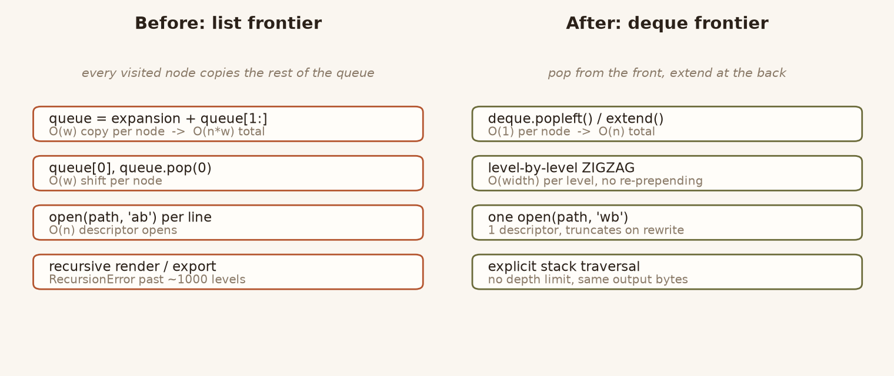
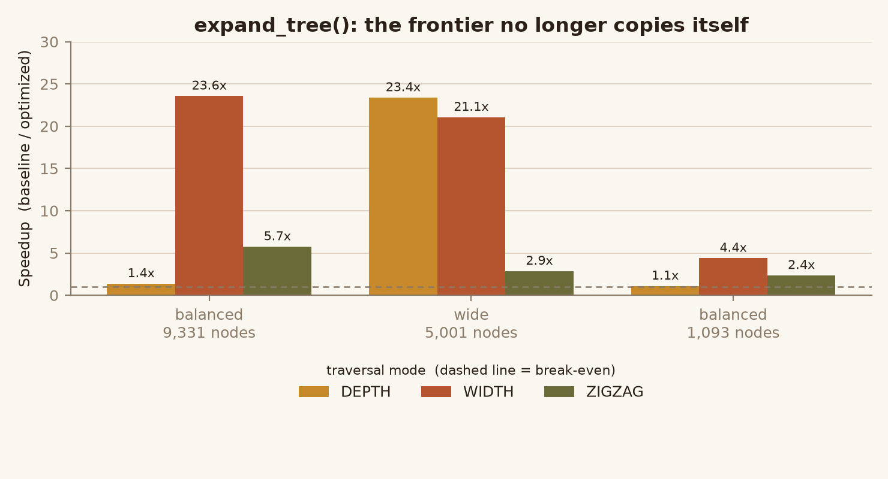
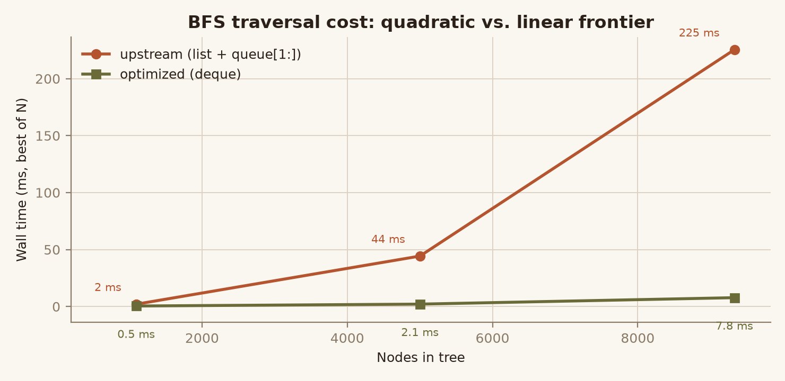
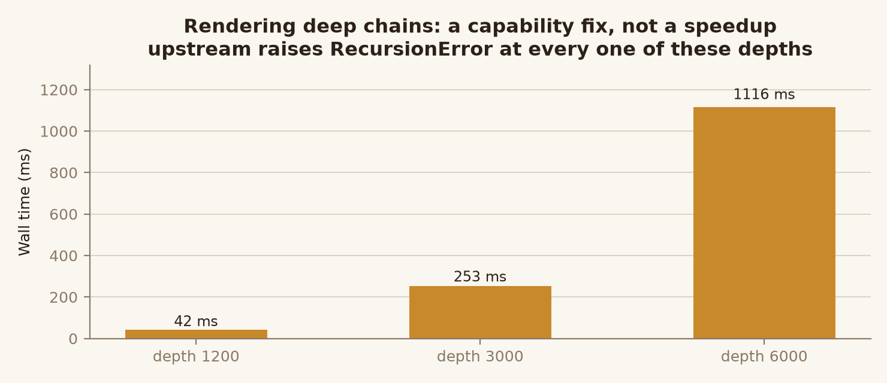
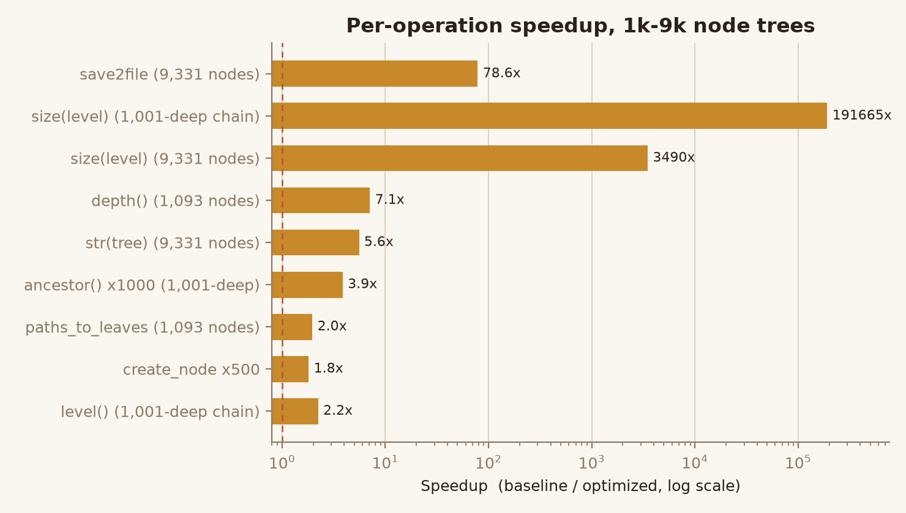

# treelib-perf-opt

Performance and robustness rewrite of [`treelib`](https://github.com/caesar0301/treelib) —
a compact, dependency-light tree data structure for Python.

The target was not "make the syntax shorter". Profiling a 9,331-node tree showed that
several routines had the wrong *algorithmic shape*: breadth-first traversal copied its own
queue once per visited node, `size(level=n)` recomputed a root-to-node walk for every node
in the tree, `save2file` reopened the output file once per rendered line, and every
renderer/export path was recursive, so any chain deeper than ~1,000 levels raised
`RecursionError`. Those are the things this repository fixes.

**Headline results** (9,331-node balanced tree; interleaved measurement; median of per-run ratios):

| Operation | Before | After | Speedup |
|---|---:|---:|---:|
| `expand_tree(mode=WIDTH)` | 225.4 ms | 7.8 ms | **23.6x** |
| `size(level=2)` | 13.2 ms | 0.004 ms | **≈3,500x** |
| `save2file()` | 2,173 ms | 26.8 ms | **78.6x** |
| `str(tree)` / `show()` | 117.8 ms | 31.0 ms | **5.6x** |
| `depth()` | 15.1 ms | 3.9 ms | **3.8x** |
| `ancestor()` ×1000 | 2.37 ms | 0.64 ms | **3.7x** |
| `create_node()` ×500 | 1.82 ms | 1.02 ms | **1.8x** |

Rendering a 1,200 / 3,000 / 6,000-deep chain: **previously impossible**
(`RecursionError`), now 42 / 253 / 1,116 ms.



---

## What was actually wrong

Every item below was confirmed by reading the upstream source at commit
[`83b3b87`](https://github.com/caesar0301/treelib/commit/83b3b87eaa7c56c9c7b86d19b2eede5252a1b482)
(`tree.py`, 2,207 lines), not inferred from docstrings.

### 1. `expand_tree()` — the frontier copied itself (O(n·w) → O(n))

```python
# upstream
while queue:
    yield queue[0].identifier
    expansion = [...]
    if mode is self.DEPTH:
        queue = expansion + queue[1:]   # full copy of the remaining queue
    elif mode is self.WIDTH:
        queue = queue[1:] + expansion   # full copy, twice
```

`queue[1:]` allocates and copies the entire remaining frontier once per visited node. For a
root with 5,000 children that is ~12.5M element copies to emit 5,000 identifiers. `pop(0)`
in the ZIGZAG branch has the same problem, and `expansion + buffer` is O(width) per node.

The rewrite preserves traversal order but uses a `deque` with `popleft()`/`extend()` for
DEPTH and WIDTH, and assembles ZIGZAG one level at a time instead of re-prepending.

Note that ZIGZAG is deliberately left **unsorted at every level**: upstream only applies
`sorting`/`key` in the DEPTH and WIDTH branches, and "fixing" that inconsistency would
silently change the order callers observe. A test pins this quirk.



The shape of the fix is visible directly in the absolute timings — upstream grows
super-linearly with node count, the rewrite stays flat:



### 2. `size(level=n)` — O(n·d) to produce a count (→ O(n))

```python
# upstream
return len([node for node in self.all_nodes_itr() if self.level(node.identifier) == level])
```

`level()` walks to the root. Doing that for every node turns one count into a root-walk per
node. On a 1,001-deep chain, counting a single level cost 93 ms — the tree was walked 1,001
times. The rewrite performs one descent that tracks depth as it goes and prunes subtrees
below the target level.

There is **no** per-node size cache: a cache would have to be maintained on every
`create_node`/`remove_node`/`move_node`/`paste` path, and a single missed invalidation
returns stale counts. One linear pass needs no invalidation at all.

### 3. `save2file()` — one file handle per rendered line

```python
# upstream
def handler(x):
    return _write_line(x, open(filename, "ab"))   # opened per line, never closed
```

Two separate defects:

* **Correctness.** `"ab"` appends, so calling `save2file()` twice on the same path writes
  the tree twice. Reproduced before fixing: 67 bytes → 134 bytes.
* **Performance.** Re-opening the file (and letting refcounting close the leaked handle)
  for every node made a 9,331-node save take 2.2 seconds.

A single `with open(filename, "wb")` fixes both. One regression test asserts that a second
write produces byte-identical output, another that descriptors are not leaked.

### 4. Deep trees — every renderer and exporter was recursive

`__get_iter` (used by `show`, `save2file`, `str`) and `to_dict` (used by `to_json`) both
recursed once per level. Above ~1,000 levels `str(tree)` raised `RecursionError`, so a
nested file path or a long comment thread simply could not be printed.

Both are now iterative. `to_dict` keeps a **recursive fast path** with an iterative
fallback: measurement showed the recursive version is genuinely faster on shallow trees
(dict building dominates; call overhead does not), so paying the iterative cost on every
call would have been a regression. It switches to the fallback only after a
`RecursionError`. This is why `to_dict` shows ~1.1x instead of a large win — the point there
is capability, not speed.

`to_json()` is **not** fixed: `json.dumps` is itself recursive in CPython's C encoder, so
serialising a multi-thousand-deep nested dict still overflows. That is a stdlib limit, and
this README does not claim otherwise.



### 5. Rendering — O(n²) string accumulation

```python
# upstream, in both __str__ and show
def write(line):
    self._reader += line.decode("utf-8") + "\n"   # reallocates the whole string per node
```

Incremental `+=` on a string rebuilds the entire accumulated buffer once per node. Lines
are now collected in a list and joined once. Prefix construction also stopped calling
`self[i]` — a `try/except`-wrapped dict lookup — three times per node for identifiers that
are already known to exist.

### 6. `ancestor(nid, level=k)` — O(d²) predecessor hops (→ O(d))

Upstream called `self.level()` — itself a full root walk — on every hop up the chain, and
again to validate the target level. The rewrite walks up once, collects the chain, and
indexes it by level.

### 7. `paths_to_leaves()` — re-walked the shared path per leaf

`self.rsearch(leaf)` per leaf re-traverses the shared upper part of the tree for every
single leaf. Paths are now memoised per node, with a direct walk for the single-leaf case —
memoising a path that will never be reused was itself a 14x regression on a chain.

### 8. `create_node()` — four closures and a `locals()` lookup per inserted node

`Node.update_successors` built four nested function objects, a dispatch dict, and performed
a `locals()` name lookup on **every** call, purely to branch on `mode`. Replaced with a
plain if/elif chain.



---

## How the numbers were produced

Claims like this are easy to fabricate, so `bench/` is built to make them falsifiable.

* **Two real variants.** `bench/baseline/treelib/` is the upstream package at commit
  `83b3b87`, byte-identical (`tree.py` sha1 `6978baec…`). Both are imported in one process
  from explicit directories, so no reinstall or import cost is measured.
* **Interleaved pairs.** For each repetition the baseline and the optimized version are
  timed back-to-back and only their **ratio** is kept. The headline figure is the median of
  those ratios; the min/max spread is in `results.json`. Comparing two independently
  collected medians picks up CPU-frequency drift instead of the effect.
* **Calibrated batch sizes.** A single 0.3 ms call is dominated by scheduler jitter — the
  interquartile range of ratios was wider than the effect being measured. Each case is
  auto-calibrated to run for at least 20 ms per sample.
* **Best-of-N, not one shot.** Each measurement is the best of several batches.
* **Not everything is faster.** `deep_1k: expand_tree ZIGZAG` lands at 0.97x and `to_json`
  hovers around 1.0–1.1x. Those are reported as-is. On a pure chain there is nothing to
  gain: the frontier never grows past one element, so the copy it used to perform was never
  expensive. The wins come from *wide* and *large* trees, which is exactly where the old
  code was quadratic.
* **Failures are recorded, not hidden.** Cases where upstream raises `RecursionError` are
  written with `median_ratio: null` and a note, never with a fabricated ratio.

Reproduce:

```bash
python bench/benchmark.py          # writes bench/results.json
python bench/make_charts.py        # regenerates every figure in assets/
```

Machine behind the numbers in this README: Windows, CPython 3.13.14, AMD64 (Zen 4).
Absolute times will differ on your hardware; the ratios are the portable part.

---

## Correctness: it is not just "tests pass"

Two independent safety nets, because a green suite on its own proves very little.

### Differential equivalence — 11,748 comparisons

`bench/differential_check.py` imports both variants and compares observable behaviour on
eight tree shapes (1 node, flat-200, deep-300, balanced, two random shapes, collapsed nodes,
duplicate tags) plus three 60-step random mutation sequences (move / remove / update /
rename / paste):

* every `expand_tree` combination — 3 modes × sorting × reverse × key × filter × subtree start;
* `str()` and `show()` across all 6 line styles × `idhidden` × `sorting` × `reverse`;
* per-node navigation (`level`, `parent`, `children`, `siblings`, `ancestor`, `rsearch`)
  for sampled nodes, including out-of-range levels that must raise;
* `size(level=n)` for every level, `paths_to_leaves`, `to_dict`, `to_json`,
  `to_graphviz`, and `save2file` bytes;
* exception **types and messages** are compared, not just return values.

Result: `checks=11748 failures=0`.

This harness earned its keep — it caught three real regressions introduced during the rewrite:

1. the ZIGZAG rewrite sorted the root level, which upstream never does;
2. the first `paths_to_leaves` rewrite returned leaves in DFS order instead of
   `_nodes` insertion order;
3. the first `to_dict` rewrite was 14% slower on shallow trees.

### Mutation testing — 13/13 injected bugs caught

`bench/mutation_test.py` copies the package to a temp dir, injects one deliberate bug at a
time, and asserts that the harness **fails**. A harness that passes everything catches
nothing.

| Injected bug | Caught by |
|---|---|
| DEPTH pushes children in wrong order | `flat200 expand DEPTH` |
| WIDTH behaves like DEPTH | `balanced expand WIDTH` |
| DEPTH ignores `reverse=True` | `flat200 expand DEPTH reverse` |
| Last-child corner glyph replaced by box glyph | `flat200 str` |
| Vertical guide dropped from prefix | `balanced str` |
| `level()` off-by-one | `single level(only)` |
| `size(level)` descent bound off-by-one | `flat200 size(level=1)` |
| `depth()` forgets `+1` when descending | `flat200 depth` |
| `ancestor()` returns wrong end of chain | `flat200 ancestor` |
| `paths_to_leaves()` drops the root | `flat200 paths_to_leaves` |
| `save2file` reopens in append mode | `save2file not idempotent` |
| `update_successors(DELETE)` removes nothing | non-zero exit |
| `to_dict` drops data/identifier payload | `single to_dict data+id` |

---

## Install and run

```bash
git clone https://github.com/<your-account>/treelib-perf-opt.git
cd treelib-perf-opt

python -m venv .venv
# Windows: .venv\Scripts\activate      Linux/macOS: source .venv/bin/activate

pip install pytest            # the library itself only needs `six`
python -m pytest tests/ -q    # 242 passed, 1 skipped

pip install matplotlib                # only needed to regenerate figures
python bench/differential_check.py    # behavioural equivalence vs upstream
python bench/benchmark.py             # benchmark -> bench/results.json
python bench/mutation_test.py         # verify the harness catches bugs
```

Requirements: Python 3.8+. Runtime dependency: `six`, same as upstream. The package ships a
`py.typed` marker, so type checkers pick up the existing annotations.

### Using it as a drop-in replacement

```python
import sys
sys.path.insert(0, "treelib-perf-opt")   # or: pip install -e treelib-perf-opt
from treelib import Tree

tree = Tree()
tree.create_node("root", "root")
tree.create_node("child", "c1", parent="root")

print(tree.show(stdout=False))
print(list(tree.expand_tree(mode=Tree.WIDTH)))
```

The public API is unchanged. Every behaviour the differential harness compares — including
ZIGZAG ignoring `sorting`, collapsed nodes exporting as bare tag strings, and the exact
exception messages — is identical to upstream.

---

## Behaviour changes

Only two, both bug fixes rather than preference:

1. **`save2file()` now truncates instead of appending.** Two calls to the same path used to
   produce a doubled file. If you relied on append semantics to accumulate output, pass
   distinct paths.
2. **`str(tree)` / `show()` / `save2file()` / `to_dict()` no longer raise `RecursionError`
   on deep trees.** Code that used that exception as an implicit depth guard will no longer
   see it.

`to_json()` still raises `RecursionError` on very deep trees (stdlib `json` limitation).

---

## Repository layout

```
treelib/                    optimized package (drop-in)
  tree.py                   traversal, rendering, exports, navigation
  node.py                   parent/child pointer bookkeeping
tests/
  test_*.py                 upstream suite, unmodified (211 tests)
  test_optimizations.py     regression tests for the fixes above (31 tests)
bench/
  baseline/treelib/         upstream package at 83b3b87, byte-identical
  benchmark.py              interleaved benchmark -> results.json
  results.json              recorded measurements (source of the README numbers)
  differential_check.py     11,748 behavioural comparisons vs upstream
  mutation_test.py          13 injected bugs, asserts each is caught
  make_charts.py            renders assets/*.png from results.json
assets/                     figures referenced by this README
```

## Credits and licence

Upstream project: [`caesar0301/treelib`](https://github.com/caesar0301/treelib) by Xiaming
Chen and contributors, **Apache-2.0**. This repository is a derivative work under the same
licence — see [`LICENSE`](LICENSE) and [`NOTICE.md`](NOTICE.md) for what changed and by whom.

`bench/baseline/treelib/` is included **only** so the benchmark and the differential harness
can import the unmodified original next to the rewrite; it is not part of the shipped
package.
